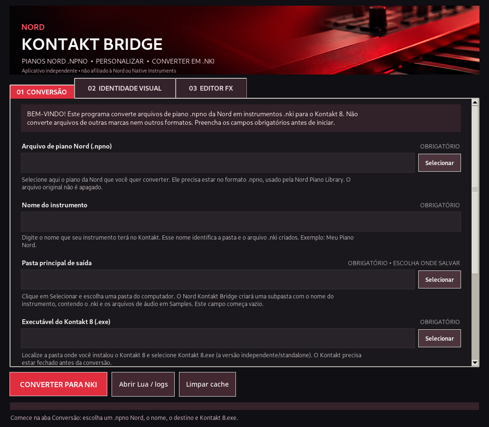
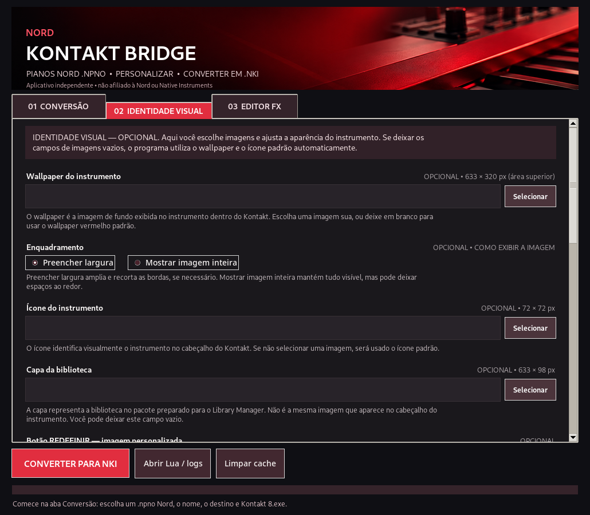
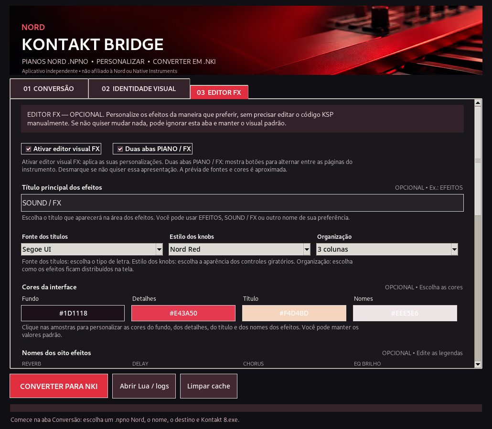
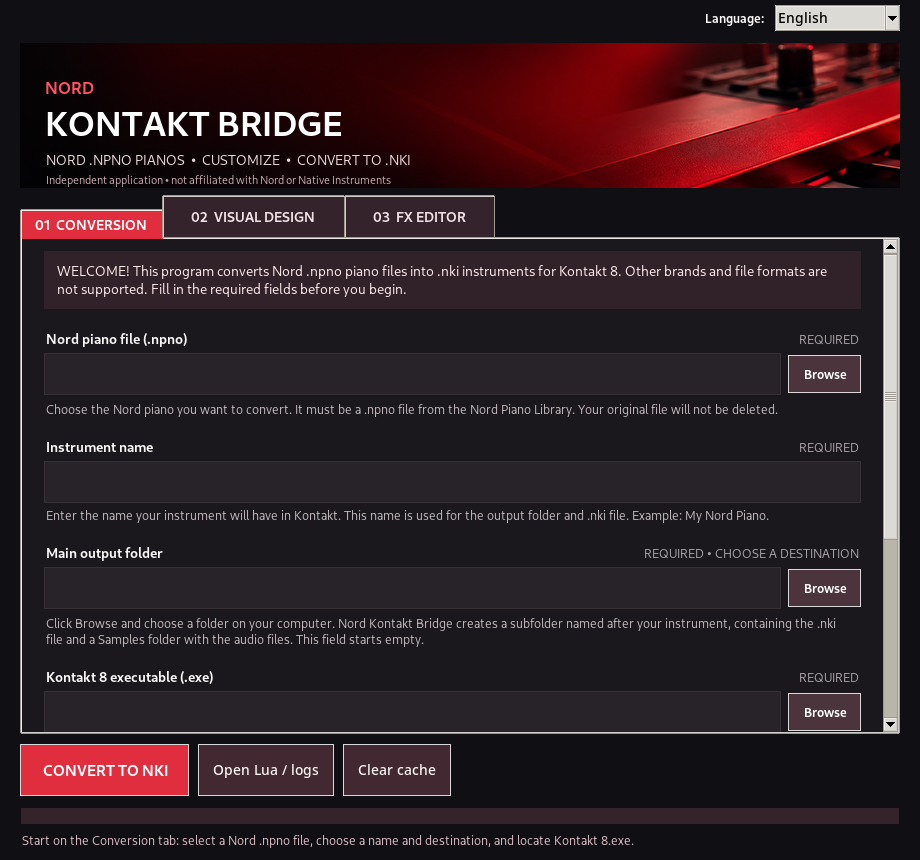
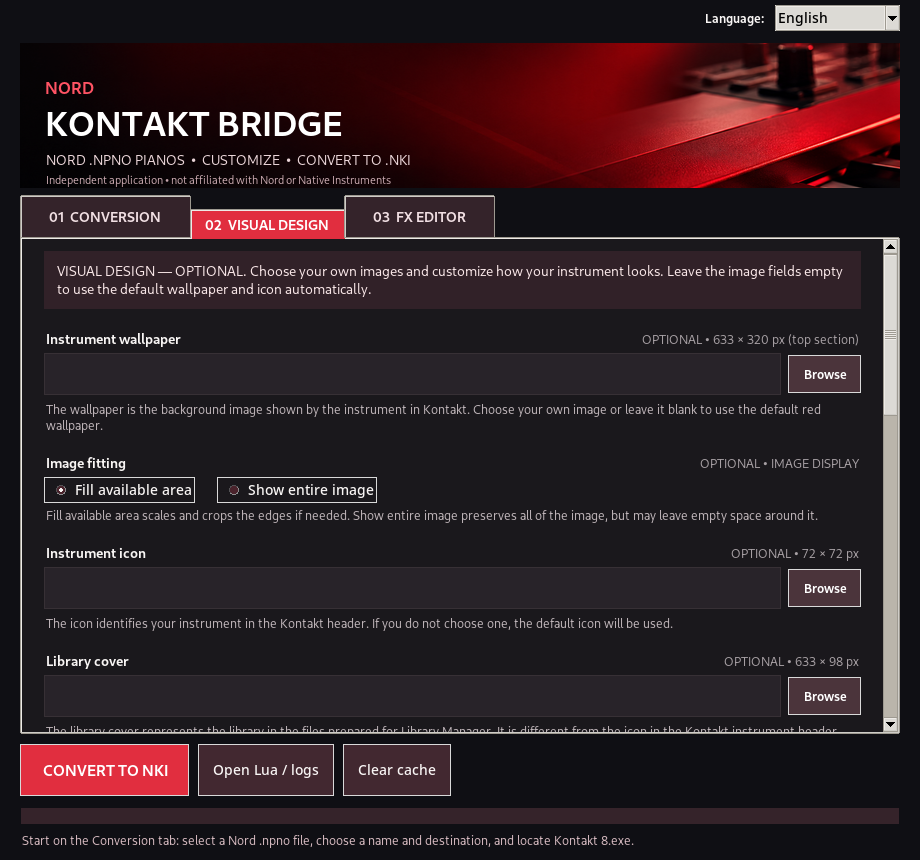
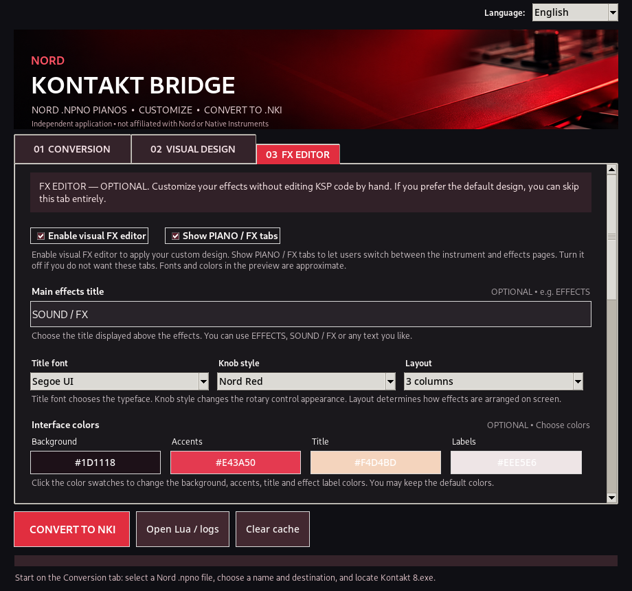

# Nord Kontakt Bridge

**Nord Piano Library `.npno` → Kontakt 8 `.nki`**

**Converter • Personalizar • Criar | Convert • Customize • Create**

**[🇧🇷 Português](#portugues) · [🇺🇸 English](#english)**

---

## 🇧🇷 Português

**Transforme seus instrumentos Nord em bibliotecas para o Kontakt 8, do seu jeito.**

O **Nord Kontakt Bridge** foi desenvolvido para facilitar a preparação e a conversão de instrumentos de piano da **Nord** para o **Kontakt 8**, usando arquivos `.npno` da **Nord Piano Library** para criar instrumentos `.nki`, o formato utilizado pelo Kontakt.

O programa é destinado exclusivamente aos arquivos `.npno` de piano da Nord compatíveis com seu conversor. Não converte arquivos `.npmo`, `.nsmp`, formatos de outras marcas ou arquivos simplesmente renomeados.

Com uma interface simples e intuitiva, o Nord Kontakt Bridge reúne em um único lugar as ferramentas necessárias para preparar, converter e personalizar seus instrumentos, mesmo que você nunca tenha utilizado o programa antes.

### Como funciona?

Para começar, selecione o arquivo `.npno` do instrumento Nord que deseja converter, informe o nome do instrumento, escolha a pasta onde deseja salvar sua biblioteca e indique o caminho do executável `Kontakt 8.exe` instalado no computador.

A conversão requer **Kontakt 8 (versão standalone)** e um decodificador Nord compatível (`nord.exe`, fornecido separadamente). O programa prepara os arquivos de áudio e os scripts necessários; o Kontakt participa da criação do arquivo `.nki`.

Você também pode selecionar um arquivo `.nkr` válido, caso tenha um modelo de recursos compatível. **O arquivo `.nkr` não acompanha necessariamente a distribuição** e não deve ser confundido com o arquivo `.npno` de origem.

Depois de configurar as opções necessárias, inicie o processo para preparar e gerar seu instrumento `.nki` destinado ao Kontakt 8.

### Personalize seu instrumento

Além da conversão, o Nord Kontakt Bridge oferece opções para personalizar a aparência e os recursos da sua biblioteca.

Você pode adicionar seu próprio **wallpaper**, **ícone** e **capa da biblioteca**, utilizar um **script KSP personalizado** e configurar a aparência dos efeitos pelo **Editor FX**.

No Editor FX, é possível personalizar o design dos knobs, os nomes dos efeitos, as fontes, as cores, os títulos e a apresentação das páginas **Piano** e **FX**, criando uma interface de acordo com suas preferências.

**Todas essas personalizações são opcionais.** Você não precisa criar imagens nem conhecer programação para começar. O programa oferece configurações padrão para facilitar sua primeira utilização.

Se você não selecionar imagens próprias, o Nord Kontakt Bridge utilizará automaticamente o wallpaper e o ícone padrão.

### Integração com o Library Manager

O programa também oferece uma opção para **preparar arquivos para o Library Manager**, incluindo recursos de identificação e apresentação da biblioteca.

**Recomendamos manter essa opção ativada.** Ela facilita a etapa de adição no gerenciador, mas a biblioteca ainda precisa ser adicionada manualmente no Library Manager; a opção não realiza registro automático.

### Pronto para começar?

Com o Nord Kontakt Bridge, você pode preparar instrumentos `.nki` para Kontakt 8 a partir de arquivos de piano `.npno` da Nord, com liberdade para personalizar a aparência da biblioteca.

**Selecione seu instrumento Nord, configure as opções desejadas e comece sua conversão!**

### Telas do programa

**1. Conversão —** Selecione o arquivo Nord, escolha o nome e a pasta de saída e informe o caminho do Kontakt 8.

**2. Identidade Visual —** Configure wallpaper, ícone, capa e outras opções de apresentação da biblioteca.

**3. Editor FX —** Personalize efeitos, knobs, títulos, cores, fontes e páginas Piano / FX.

### Download e requisitos

Baixe a versão desejada na seção **Releases** deste repositório:

- **`Nord Kontakt Bridge Portable.exe`** — abre no Windows sem instalador e sem exigir Python.
- **`Nord Kontakt Bridge Installer.exe`** — instala o programa com atalhos e opção de desinstalação.

**Requisitos:** Windows, Kontakt 8 standalone instalado, arquivo de piano `.npno` compatível e decodificador `nord.exe` obtido separadamente. O Kontakt 8 e o decoder não acompanham o aplicativo. Se o decodificador não estiver configurado, a conversão poderá não funcionar.

Escolha um dos EXEs e execute-o. No primeiro uso, selecione seu arquivo Nord, o nome do instrumento, a pasta de destino e o caminho de `Kontakt 8.exe`.

> **Aviso:** o Nord Kontakt Bridge é um projeto independente, sem afiliação oficial com a Nord ou a Native Instruments. O programa não inclui o Kontakt 8, instrumentos comerciais da Nord, um decodificador externo nem licenças de terceiros.

---

## 🇺🇸 English

**Turn your Nord piano instruments into Kontakt 8 libraries, your way.**

**Nord Kontakt Bridge** was created to make preparing and converting **Nord** piano instruments for **Kontakt 8** easier. It takes compatible **Nord Piano Library** `.npno` files and helps create `.nki` instruments, the format used by Kontakt.

The application is intended exclusively for compatible Nord piano `.npno` files. It does not convert `.npmo`, `.nsmp`, other manufacturers' formats, or files that have simply been renamed.

With a straightforward interface, Nord Kontakt Bridge brings together the tools needed to prepare, convert, and customize your instrument—even if this is your first time using the application.

### How does it work?

Start by selecting the Nord `.npno` piano file you want to convert, entering an instrument name, choosing an output folder, and locating the installed `Kontakt 8.exe` executable.

Conversion requires **Kontakt 8 (standalone)** and a compatible Nord decoder (`nord.exe`, distributed separately). The application prepares the necessary audio files and scripts; Kontakt is involved in creating the final `.nki` file.

You can also select a valid `.nkr` resource file if you already have a compatible resource template. **An `.nkr` file is not necessarily included in the distribution** and should not be confused with the original `.npno` piano file.

Once you have configured the required options, start the process to prepare and create your `.nki` instrument for Kontakt 8.

### Customize your instrument

In addition to conversion, Nord Kontakt Bridge provides tools to customize the appearance and behavior of your library.

You can choose your own **wallpaper**, **instrument icon**, and **library cover**, supply a **custom KSP script**, and design the effect controls using the **FX Editor**.

The FX Editor lets you customize knob designs, effect names, fonts, colors, titles, and **Piano / FX** pages so the interface matches your preferences.

**All these customizations are optional.** You do not need to create artwork or know how to program to get started. The application provides default settings for new users.

If you do not select custom images, Nord Kontakt Bridge automatically uses its default wallpaper and icon.

### Library Manager integration

The application also includes an option to **prepare files for Library Manager**, including identification and presentation resources for the library.

**We recommend leaving this option enabled.** It makes the later library-addition step easier, but you still need to add the library manually in Library Manager; this option does not register it automatically.

### Ready to get started?

Nord Kontakt Bridge lets you prepare Kontakt 8 `.nki` instruments from compatible Nord `.npno` piano files, while giving you the freedom to customize your library's appearance.

**Choose your Nord instrument, set your preferences, and start converting!**

### Application screenshots

**1. Conversion —** Select your Nord file, enter an instrument name, choose an output directory, and locate Kontakt 8.

**2. Visual Design —** Customize the wallpaper, instrument icon, library cover, and other appearance settings.

**3. FX Editor —** Customize effects, knobs, titles, colors, fonts, and Piano / FX pages.

### Downloads and requirements

Download the executable you prefer from this repository's **Releases** section:

- **`Nord Kontakt Bridge Portable.exe`** — runs on Windows without installation or Python.
- **`Nord Kontakt Bridge Installer.exe`** — installs the app, shortcuts and an uninstaller.

**Requirements:** Windows, Kontakt 8 standalone, a compatible `.npno` piano file and the separately obtained `nord.exe` decoder. Kontakt 8 and the decoder are not bundled. Conversion may not work without a configured decoder.

Run either EXE. For your first conversion, select the Nord piano file, instrument name, output folder, and the `Kontakt 8.exe` path.

> **Disclaimer:** Nord Kontakt Bridge is an independent project and is not officially affiliated with Nord or Native Instruments. It does not include Kontakt 8, commercial Nord instruments, an external decoder, or third-party licenses.
